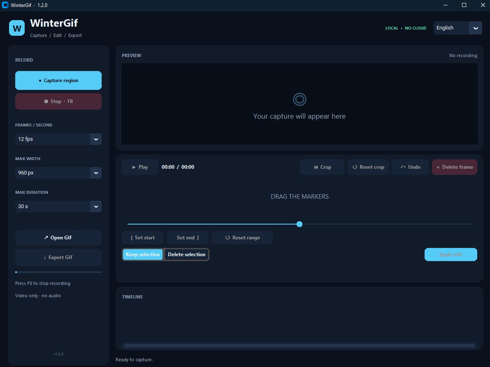

# WinterGif

### Capture. Refine. Share.

**A lightweight, offline screen recorder and GIF editor for Windows.**

Made for clean, quick GIFs without online services, accounts, or unnecessary complexity.

---

## The application

WinterGif v1.2.0 · Dark-mode desktop interface

## About

**WinterGif** is a focused desktop utility for turning screen recordings into animated GIFs. Select the area you want to capture, preview the result, remove unnecessary frames, crop the image, and export a GIF without leaving the application.

Designed as a small, practical tool for recording **software interfaces, game animations, tutorials, bug reproductions, and portfolio demonstrations**.

### Highlights

| | Feature | What it does |
|:--:|---|---|
| 🎯 | **Region capture** | Record only the portion of your screen that matters. |
| ▶️ | **Playback & preview** | Review your recording before saving it. |
| ✂️ | **Timeline selection** | Set the beginning and end of the section you want to edit. |
| 🧹 | **Keep or delete** | Preserve a selected range or remove unwanted frames. |
| 🖼️ | **Cropping** | Focus the output on the relevant content. |
| ↩️ | **Undo** | Revert editing operations. |
| ⚙️ | **Capture controls** | Adjust FPS, maximum width, and recording duration. |
| 🌐 | **Bilingual UI** | Switch between English and Brazilian Portuguese. |
| 🔒 | **Local-first** | Capture, edit, and export without sending content to the cloud. |

## The workflow

**Select an area** &nbsp; → &nbsp; **Record** &nbsp; → &nbsp; **Preview** &nbsp; → &nbsp; **Edit frames** &nbsp; → &nbsp; **Export GIF**

1. **Capture:** Select a region of the screen and start recording.
2. **Stop:** Use the on-screen control or press **F8**.
3. **Preview:** Play the captured sequence and inspect its frames.
4. **Refine:** Use the timeline markers to choose which frames to keep or delete; crop if needed.
5. **Export:** Save the result as an animated GIF.

> **Note:** GIF is a silent format. WinterGif captures visuals, not audio.

## Designed for

| Creators | Developers | Game designers |
|---|---|---|
| Tutorial snippets and visual posts | Bug reports and UI demos | Animation previews and gameplay clips |

## Behind the project

WinterGif was developed in **Python**, using **CustomTkinter** for its dark desktop UI, **MSS** for screen capture, and **Pillow** for image processing and GIF export.

The goal was to keep the workflow straightforward: fewer distractions, clear controls, and useful editing tools in a single window.

### Privacy & portability

- **Offline workflow:** recordings and edits are processed locally.
- **No account required:** no registration or online dashboard.
- **Windows-focused:** the interface is designed for Windows desktop use.
- **Portable distribution planned:** compiled builds can bundle Python dependencies so end users do not need Python installed.

## Repository status

> **Project showcase**
>
> This repository currently contains **documentation, a screenshot, and a license**. The application source code and compiled executable are **not included here**. This page demonstrates the project; it is not presently a download or build guide.

The screenshot above shows the application UI. Future demonstrations or downloadable builds can be added without changing the overall structure of this page.

## Author

**Alexandre Kamimura Paulo** · [AlexWintersky](https://github.com/AlexWintersky)  
Contact: [wintersky.dev@gmail.com](mailto:wintersky.dev@gmail.com)

## License

See the [MIT license](LICENSE) for the materials included in this repository. The license does not imply that unpublished application code is available here.

---

WinterGif · Built for simple, fast, offline GIF workflows.

